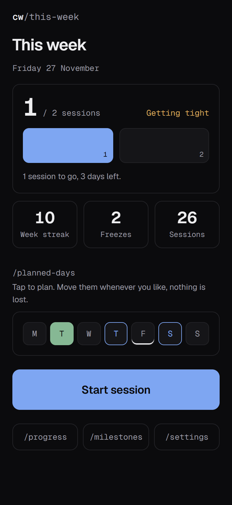
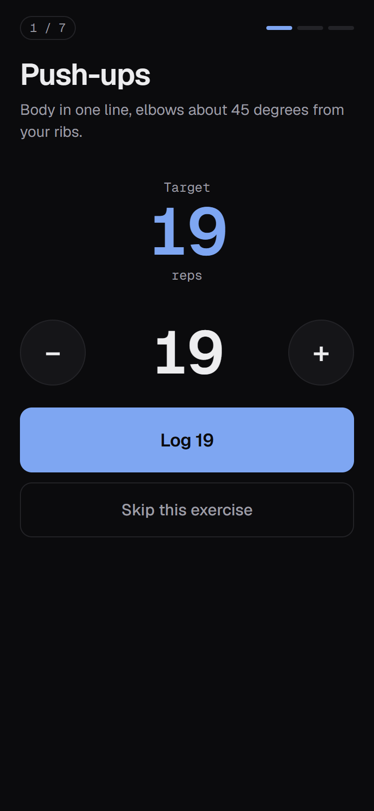
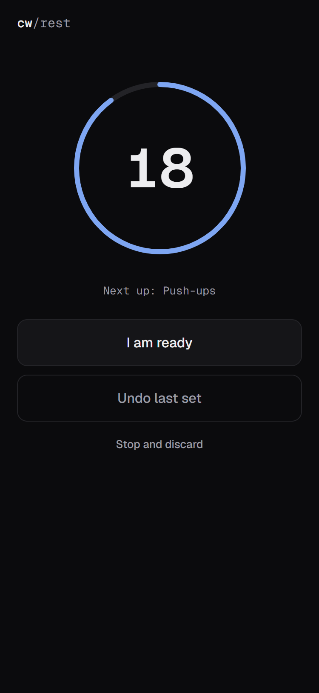
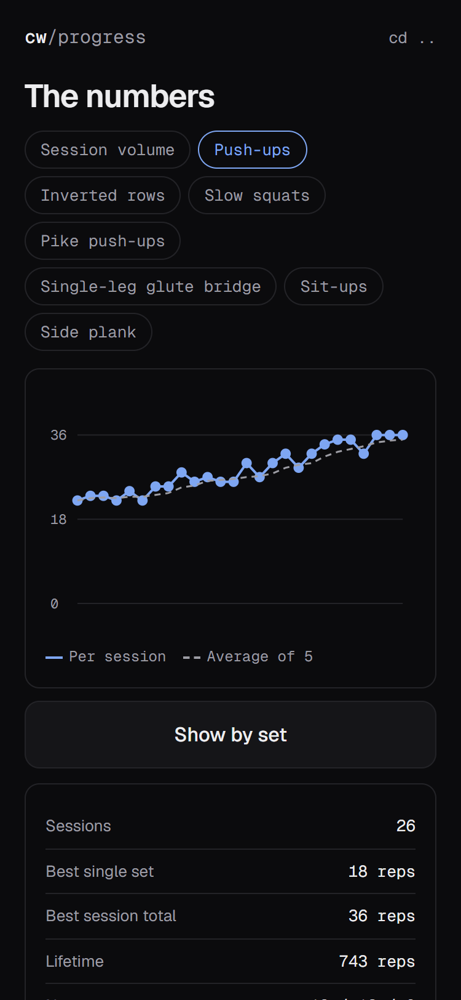
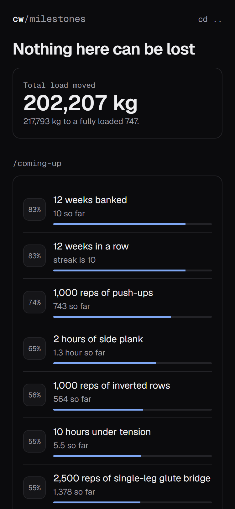

# calisthenics-workouts

A small training log for a fixed bodyweight programme. It runs in the browser as a
progressive web app, works offline once loaded, and keeps all data on the device.

It guides a session from warm-up to the last set: timed warm-up moves, a target for every set,
rest timers with short beeps, and a log of what was done. Progress charts and milestones are
worked out from that log.

## Screenshots

Synthetic demo data, 375 x 812.

<p>
  
  
  
  
  
</p>

## Design

- **Weekly banking instead of a daily streak.** Each week (Monday to Sunday) has a target of
  two sessions. A week that reaches the target is banked, and the streak counts banked weeks in
  a row. A missed day costs nothing; a missed week does.
- **Freezes.** A week with three sessions or more earns a freeze, up to two stored. A week that
  falls short spends a freeze instead of breaking the streak.
- **A week card that shows today's cost.** The home screen shows this week's sessions and how
  tight the remaining days are (on track, getting tight, at risk, out of days).
- **Adaptive per-set targets.** For exercises done to failure, the target for each set is one
  more than the best of the last three sessions at that set. The single-leg bridge target
  follows the weakest set of the last session: when every set met the target, it asks how it
  felt and adds one (easy), keeps it (about right) or takes one off (hard).
- **Timed holds that stop on their own.** The side plank counts down from a fixed target per
  side (30 s by default, set in Settings) and logs it at zero. "Dropped early" logs the time
  actually held.
- **Skipping is not failing.** An exercise can be skipped before its first set. Nothing is
  logged for it, so its targets and charts are untouched, and the session-volume chart draws
  that session as a hollow point.
- **Backpack rows.** The pull is a one-arm row with a loaded backpack, logged per arm. The pack
  weight is set in Settings (asked for on the first set if empty) and saved with each session,
  so changing it later never changes past load moved.
- **Archived exercises.** Inverted rows left the programme when backpack rows replaced them.
  Their chart stays under an "(archived)" chip, and their reps keep counting toward lifetime
  totals, load moved, time under tension and milestones. The session-volume chart marks where
  the programme changed.
- **Milestones that cannot be lost.** Lifetime reps and hold time per exercise, sessions,
  banked weeks, total load moved and time under tension.
- **Derived, not stored.** Streak, freezes, totals and milestones are recomputed from the
  session log every time, so there is no counter that can drift.

## Data and privacy

- Everything is stored in the browser's `localStorage`. There is no account, server or
  analytics.
- The data is one JSON value under the key `workouts.v2`:
  `{v:2, bw, pack, sessions:[{id, ts, log, pack}], commits, targets:{bridge, plank}}`. A
  session's `log` maps each exercise done to its sets; a skipped exercise has no entry. `pack`
  is the backpack weight in kg; a session has it only when backpack rows were done.
- Settings has export and import to a JSON file. Import accepts only files in this format.
  Export now and then: clearing the browser's data, or removing a home-screen app on iOS,
  deletes the log.
- On iOS, add the page to the home screen. It then runs full screen and keeps its own storage.

## Run locally

Any static file server works. With Python:

```sh
python -m http.server 8000
```

Then open http://localhost:8000. The service worker caches the app, so a normal reload can show
the previous version; hard-reload or unregister the service worker while developing.

## Tests

The tests use Node's built-in test runner and need no packages (Node 22 or later):

```sh
node --test "test/*.test.js"
```

or `npm test`. They cover the pure logic: ISO weeks, banking and freezes, the week card,
targets, lifetime totals, milestones and chart output, using synthetic data in
`test/fixtures/`. GitHub Actions runs them on every push and pull request.

## Project structure

```
index.html             markup for every screen
css/app.css            styles
fonts/                 Geist and Geist Mono (latin subset, SIL OFL 1.1)
js/main.js             entry point: loads data, wires screens, registers the service worker
js/config.js           exercises, timings, warm-up, food suggestions, milestone tiers
js/store.js            localStorage load and save, export and import
js/weeks.js            ISO weeks, banking, streak and freezes, week card state
js/targets.js          exercise history and per-set targets
js/milestones.js       lifetime totals, load moved, time under tension, milestones
js/chart.js            progress chart as SVG
js/audio.js            beeps
js/ui.js               screens, painting and navigation
js/player.js           session flow: warm-up, sets, rests, feedback, finish
js/settings.js         settings screen and the bodyweight question
sw.js                  service worker (offline cache)
manifest.webmanifest   home-screen install
icons/                 home-screen icons
docs/screenshots/      README screenshots (synthetic data)
test/                  node --test tests and synthetic fixtures
```

The modules under `js/` that hold logic (`weeks`, `targets`, `milestones`, `chart`, `config`)
do not touch the DOM, so the tests import them directly.

There is no build step, framework or dependency. GitHub Pages serves the repository as it is.
